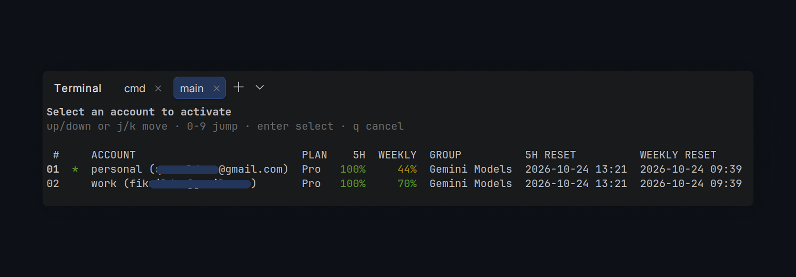
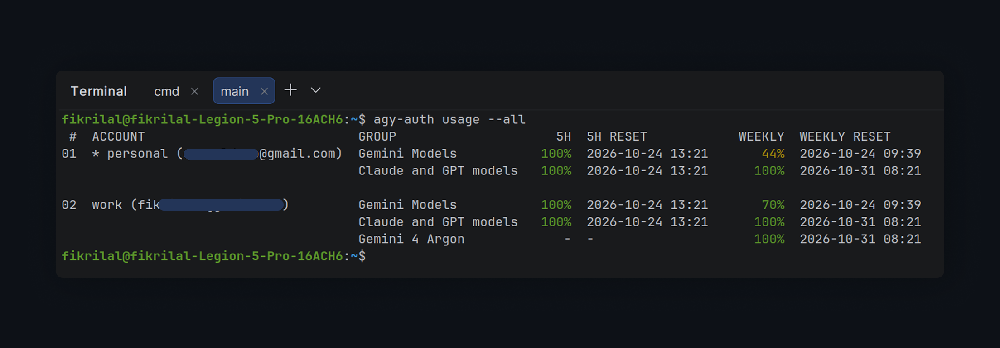

# agy-auth

[](https://www.npmjs.com/package/@fikrilal/agy-auth)
[](https://github.com/fikrilal/agy-auth/actions/workflows/ci.yml)
[](LICENSE)

`agy-auth` is an unofficial multi-account switcher for [Google Antigravity CLI](https://antigravity.google/docs/cli/overview) (`agy`). Keep personal, work, and test accounts side by side, switch the live credential, and see plan and quota limits without signing in again.



## Highlights

- Switch accounts by row number, alias, email, or account ID.
- See plan, 5-hour, weekly, group, and reset columns in `list` and `switch`.
- Automatically rotate to accounts with remaining 5-hour quota with `agy-auth rotate`.
- Compare Antigravity quota groups with `agy-auth usage` and `usage --all`.
- Use live views with automatic switching away from exhausted groups.
- Keep encrypted account snapshots and automatic backups.

## Install

npm is the recommended install:

```shell
npm install -g @fikrilal/agy-auth
agy-auth version
```

Run it without a global install:

```shell
npx @fikrilal/agy-auth list
```

> The unscoped npm name `agy-auth` is an unrelated project. Install `@fikrilal/agy-auth`; it provides the `agy-auth` command.

## Quick start

```shell
# Add an account directly through Google OAuth.
agy-auth login --alias personal

# Already signed in with agy? Save that account instead:
# agy-auth add --alias personal

# Add a second account.
agy-auth login --gcp --project my-gcp-project --region global --alias work

# Inspect and switch.
agy-auth list
agy-auth switch work

# Toggle back to the previous account.
agy-auth switch -
```

After switching, restart `agy`; a running session keeps the old credential in memory. By default, `agy-auth switch` updates both the CLI credential and Antigravity Desktop profile; use `--relaunch` to restart Desktop automatically.

## Commands

| Command | Description |
|---------|-------------|
| `agy-auth list [--active] [--no-sync] [--no-usage] [--live]` | List accounts, plan, and quota |
| `agy-auth add [--alias <alias>] [--gcp --project <id> [--region <region>]] [--target all\|cli\|desktop]` | Save the account signed in to agy or Desktop |
| `agy-auth login [--alias <alias>] [--gcp --project <id> [--region <region>]] [--no-browser] [--via-agy]` | Add an account through Google OAuth |
| `agy-auth switch [<query>\|-] [--live] [--target all\|cli\|desktop] [--relaunch]` | Switch interactively, by query, or to the previous account |
| `agy-auth rotate [--target all\|cli\|desktop] [--relaunch] [--force]` | Automatically switch to an account with remaining quota |
| `agy-auth remove [<query>...] [--all] [--logout] [--yes] [--live]` | Remove stored accounts |
| `agy-auth alias set <query> <alias>` | Set an alias |
| `agy-auth alias clear <query>` | Clear an alias |
| `agy-auth alias list` | List aliases |
| `agy-auth current` | Print the live agy account |
| `agy-auth status` | Show storage paths and credential health |
| `agy-auth usage [<query>] [--all]` | Show or compare quota groups |
| `agy-auth config live [--interval <seconds>]` | Show or set the live refresh interval |
| `agy-auth import <file-or-dir> [--alias <alias>] [--gcp --project <id> [--region <region>]] [--activate]` | Import credential JSON |
| `agy-auth import --purge` | Rebuild the registry from stored snapshots |
| `agy-auth export [--dir <directory>] [<query>...]` | Export credentials |
| `agy-auth path` | Print storage locations |
| `agy-auth clean [--dry-run]` | Prune old backups and orphan snapshots |
| `agy-auth version [--check]` | Print the version; `--check` queries the latest release |

Queries match row number, account ID, alias, email, GCP project ID, or account ID prefix.

Global options: `--json` for machine-readable output and `--no-color` to disable colors. See the [user guide](docs/user-guide.md#json-output) for JSON details.

## Quota and live views

`agy-auth list` shows the current plan and the 5-hour/weekly quota groups, including reset times. `agy-auth usage --all` shows every group for every stored account:



```shell
agy-auth usage --all
```

For an interactive view:

```shell
agy-auth list --live
agy-auth switch --live
agy-auth remove --live
```

In `switch --live`, pressing Enter switches and keeps the view open. The view can also switch automatically when a quota group is exhausted. See the [user guide](docs/user-guide.md#quota-and-live-views) for keys and details.

## Updates

`agy-auth` checks the latest npm release at most once every 24 hours. On an interactive terminal it offers to update in place; otherwise it prints the update command. Run:

```shell
agy-auth version --check
```

to check immediately. Disable automatic checks with `AGY_AUTH_NO_UPDATE_CHECK=1`. npm installs update through npm; standalone binaries verify the release checksum before replacing themselves.

## Storage and safety

`agy-auth` uses the same credential storage as `agy` (OS keyring with a file fallback). Account snapshots and active-credential backups are encrypted with AES-256-GCM. `agy-auth path` prints the storage locations.

> Back up `~/.config/agy-auth/encryption.key` separately. Without it, encrypted snapshots cannot be recovered. Exported credentials are plaintext; delete them after use.

See [Security](SECURITY.md) and the [user guide](docs/user-guide.md#storage-and-switching) for the trust model and recovery details.

## Requirements

- Antigravity CLI installed. `agy-auth login` adds accounts directly; it uses the installed CLI to discover the OAuth client. Signing in to `agy` first is only needed for `agy-auth add` and for running `agy` after a switch.
- Linux, macOS, or Windows. Linux uses a Secret Service provider when available and otherwise falls back to file storage.
- Node.js 18+ for the npm package. The package bundles prebuilt binaries, so no Go toolchain is required.

## Learn more

- [User guide](docs/user-guide.md) — storage, quota, OAuth, JSON, environment variables
- [Security](SECURITY.md) — credential handling and reporting
- [Internals](docs/internals.md) — implementation details
- [Contributing](CONTRIBUTING.md) and [Development](docs/development.md) — building and testing
- [Release process](docs/release.md) and [Changelog](CHANGELOG.md)
- [Documentation index](docs/README.md)

## Disclaimer

This project is not affiliated with Google. Use it at your own risk. The default OAuth login uses the same public client as Antigravity CLI; review Google's terms and your account policies before using it with a work or enterprise account.
